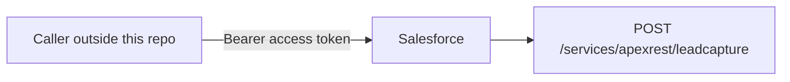
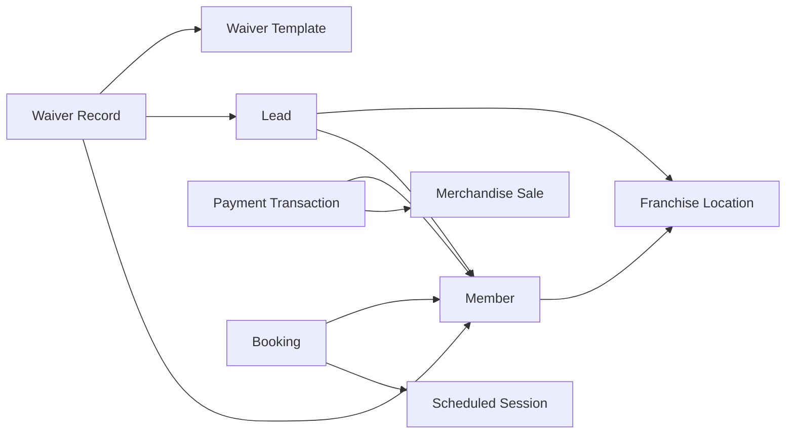

# EPIC-11 / US-D005 — API Documentation (POS Integration)

Issue: #41. Kanban: `t_24523042`.

**Status:** Draft
**Last verified:** 2026-10-27 against `main` `0a8962b`
**Checked from:** source in `force-app` (not a live HTTP call)
**Still open:** no connected app or token minting in source; `EPIC01_LeadCapture_Rest` is not on **Boxing Gym CRM Access**; no live 201/409 call from this draft; the other POS operations are CRM actions, not URLs

This is the canonical copy. The issue names `CRM-Documentation/EPIC-11_D005_API_Documentation.md`. Sync that vault from this file when the vault is available.

Staff screens for the same work are US-D001. Users and the permission set are US-D004.

The only inbound REST resource in `force-app` is `POST /services/apexrest/leadcapture`. A Postman collection for that one call is `docs/EPIC-11_D005_leadcapture.postman_collection.json`. It has no token and no org host.

## Authentication

**Not built** as a custom OAuth flow. This repo does not mint, refresh, or expire tokens, and it does not define a rate limit. There is no connected app in `force-app`. `docs/environment.md` records that connected-app creation is blocked in the Dev Hub.

The caller brings a Salesforce access token. Salesforce rejects the call before `EPIC01_LeadCapture_Rest` runs when that token's user cannot execute the class. **Boxing Gym CRM Access** does not grant `EPIC01_LeadCapture_Rest`. Add that class to a permission set in source before an integration user can call it.



Call shape:

```http
POST /services/apexrest/leadcapture
Authorization: Bearer {Salesforce access token}
Content-Type: application/json
```

Use the org's My Domain host. This repo does not publish that host.

## Lead registration

**Verified from source.** `EPIC01_LeadCapture_Rest.doPost` → `EPIC01_LeadCapture_Service.capture`. `@HttpPost` is the only method. There is no GET, PATCH, or DELETE.

Why Apex: a Flow cannot expose an inbound REST endpoint.

### Request body

| JSON field            | Required         | Notes                                                                                                                                                                                               |
| --------------------- | ---------------- | --------------------------------------------------------------------------------------------------------------------------------------------------------------------------------------------------- |
| firstName             | Yes              | Trimmed onto `First_Name__c`. `First Name is required`                                                                                                                                              |
| lastName              | Yes              | Trimmed onto `Last_Name__c`. `Last Name is required`. `Name` is first name, a space, then last name                                                                                                 |
| email                 | No               | If present, must match `^[^@\s]+@[^@\s]+\.[^@\s]+$`. `Please enter a valid email address`. Stored trimmed on `Email__c`                                                                             |
| phone                 | No               | If present, 10 digits after removing spaces, dashes, parentheses, dots, and a leading `+1`. `Please enter a valid 10-digit phone number`. The stored value is the trimmed original, not digits only |
| leadSource            | No               | Blank becomes `Web Form`. Restricted picklist. Active labels: Walk-in, In Person, Online, Referral, Social Media, Community Event, Web Form, Facebook Ad. Any other value fails the insert          |
| programInterest       | No               | Restricted picklist when set. Active values: Boxing, Fencing, MMA, Multi, Not Sure. Any other value fails the insert                                                                                |
| referralCode          | No               | Trimmed onto `Referral_Code_Entered__c`. Attribution runs after that, outside the JSON response                                                                                                     |
| franchiseLocationId   | One of these two | Salesforce Id of a Franchise Location. This lookup does not require Status Active. If both id and name are sent, the id is used                                                                     |
| franchiseLocationName | One of these two | Name of a Franchise Location whose Status is **Active**. Used only when the id is blank                                                                                                             |
| campaignMetadata      | No               | Long text on `Campaign_Metadata__c`. Used for a raw Facebook payload                                                                                                                                |

`Lead_Status__c` is set to `New`. The request cannot set it.

Example:

```json
{
  "firstName": "Maya",
  "lastName": "Rodriguez",
  "email": "maya.rodriguez@email.com",
  "phone": "336-555-0199",
  "leadSource": "Web Form",
  "programInterest": "Boxing",
  "referralCode": "SAM0KA00",
  "franchiseLocationName": "Lexington HQ",
  "campaignMetadata": "{}"
}
```

The location name in the example must already exist and be Active. This repo does not seed Lexington HQ.

### Response body

```json
{
  "success": true,
  "leadId": "a00...",
  "message": "Lead created",
  "duplicate": false,
  "errors": []
}
```

`Content-Type` is `application/json`.

| HTTP status | When                                          | message                                                                                                                                              |
| ----------- | --------------------------------------------- | ---------------------------------------------------------------------------------------------------------------------------------------------------- |
| 201         | Lead inserted                                 | `Lead created`                                                                                                                                       |
| 409         | Same `Email__c` already on a Lead             | `Lead already exists — redirecting to update flow`. `duplicate` is true. `leadId` is the existing lead. There is no update API behind that sentence. |
| 400         | Validation, unknown location, or a save error | Joined validation messages, or `A valid franchise location is required`, or the first DML message.                                                   |
| 400         | Body is not JSON of that shape                | `Invalid request body`. That string is also the only entry in `errors`.                                                                              |

Duplicate detection is email only, and it runs only when email is present. Phone is not checked for duplicates. A lead with no email can be inserted again.

Side effects after a successful insert, not in the JSON:

- A valid `referralCode` is resolved by `EPIC01_Lead_Referral_Attribution`. That flow sets `Referred_By__c` and `Lead_Source__c` to Referral.
- The lead trigger then adds 1 to the referrer's `Referral_Attempts__c` and inserts `Referral_Reward__c` with status `Code Used`.
- An unknown code leaves `Referred_By__c` blank and writes `Referral code not found — continuing without attribution` on `Notes__c`. No reward is created.
- The same email as the referring member fails the insert with `You cannot refer yourself` (HTTP 400). The lead is not created.
- An email that already belongs to a Member clears the referral, sets `Converted_Member__c` to that member, and appends `Already a member — referral not applied` on `Notes__c`. The lead insert still succeeds.
- The web form host, the trainer app, and the Facebook webhook relay are not in this repo. They would call this URL.

## POS operations that are not REST

**Not built** as HTTP endpoints. Do not call these paths. `force-app` has one `urlMapping`, `/leadcapture/*`.

These operations exist as CRM actions. They are documented for staff in US-D001. They do not accept the lead-capture JSON.

| Operation the issue names | In this repo                                                                                                     |
| ------------------------- | ---------------------------------------------------------------------------------------------------------------- |
| Lead-to-member conversion | Quick action **Convert to Member**. `EPIC01_LeadConversion_Action`                                               |
| Payment processing        | Quick action **Process Membership Payment**. `EPIC01_ProcessPayment_Action`                                      |
| Membership renewal        | Quick action **Renew Membership**. `EPIC04_RenewMembership_Action`                                               |
| Merchandise sale          | Home card **Sell Merchandise**. `EPIC04_MerchandiseSale_Controller.completeSale`                                 |
| Discount application      | Fields on that same sale call. Not a separate action                                                             |
| Refund / return           | Quick action **Refund** on the Merchandise Sale. `EPIC04_MerchandiseRefund_Action`. Full merchandise refund only |

## Objects a caller will meet

**Verified from source** as names and relationships. Field-by-field lists live under `force-app/main/default/objects/`. The lead-capture request table above is the required-field list for this API. The call does not accept Member, Payment, Waiver, sale, or refund fields.



`Referral_Reward__c` links a referring member, a referred lead, and later a referred member. The lead-capture API does not accept reward fields. A valid code creates the reward on insert, with status `Code Used`. Later CRM actions move that status. This API does not.

## Errors and retries

**Verified from source** for this endpoint only.

| Situation                       | Retry                                                                                       |
| ------------------------------- | ------------------------------------------------------------------------------------------- |
| 400 validation or location      | Fix the body. Retrying the same body fails again.                                           |
| 400 restricted picklist         | Use an active Lead Source or Program Interest value.                                        |
| 400 `You cannot refer yourself` | Drop the referral code or use a different email.                                            |
| 409 duplicate email             | Do not insert again. The response already returns the existing `leadId`. There is no PATCH. |
| 400 `Invalid request body`      | Send JSON that deserializes to the request fields.                                          |
| Salesforce auth failure         | Token or class-access problem, outside this class.                                          |
| Rate limit                      | Not implemented here. Salesforce platform limits still apply.                               |

## How to verify this draft

1. `force-app` contains `@RestResource(urlMapping='/leadcapture/*')` and no other `urlMapping`.
2. Import `docs/EPIC-11_D005_leadcapture.postman_collection.json`. Set `baseUrl` to the org My Domain and `token` to a Salesforce access token for a user who can run `EPIC01_LeadCapture_Rest`.
3. A call with a real Active location and a new email returns 201 and `Lead created`.
4. The same email returns 409.
5. Leave the other POS paths off this API until a class exposes them. A live call and that class permission are still open, so this issue stays open.
